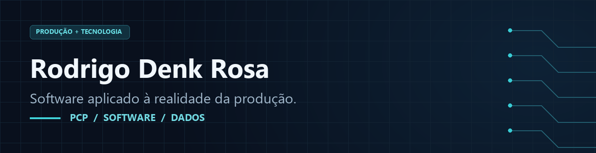
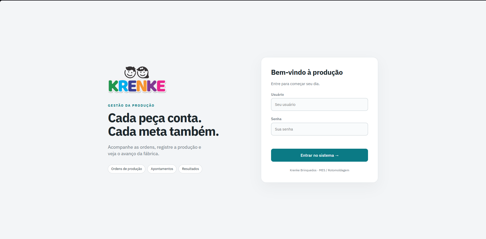
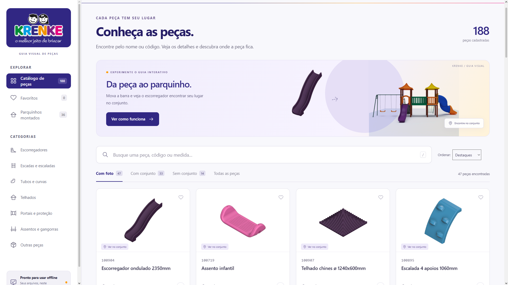
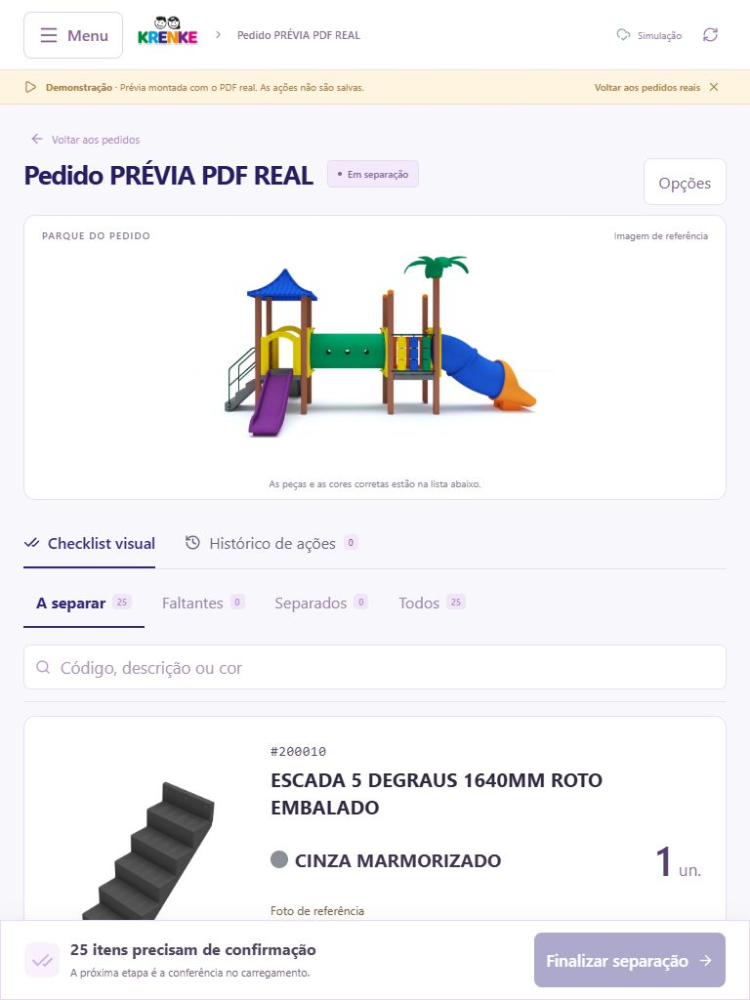

  

<a href="https://www.linkedin.com/in/rodrigo-denk-rosa-ba9922223/">LinkedIn</a> · <a href="#projeto-mes">MES</a> · <a href="#sistemavizu">VIZU</a> · <a href="#sistema-de-separação-e-conferência">Conferência</a> · <a href="https://github.com/Rodrigodenk?tab=repositories">Repositórios</a>

**PCP · Logística operacional · Melhoria de processos · FoccoERP · Sistemas para produção**

Conecto a experiência no chão de fábrica ao desenvolvimento de sistemas. Atuo em **Planejamento e Controle da Produção**, tenho experiência em **almoxarifado e movimentação de materiais** e sou **graduando em Engenharia de Software**.

### Competências na prática

- **PCP e indicadores:** programação da produção, planejamento de setups, distribuição entre máquinas, ordens de produção e acompanhamento de OEE.
- **Logística operacional:** experiência como almoxarife na WEG e operador de empilhadeira na Krenke; definição de fluxos de separação e conferência no projeto para tablet e Android.
- **Processos e eficiência:** identificação de falhas, padronização de registros e reformulação de ordens com cores e tradução para facilitar a compreensão da equipe.
- **ERP e sistemas de gestão:** uso de **FoccoERP e Excel** na rotina de PCP e participação na criação, evolução e validação de um **MES em uso profissional**.
- **Requisitos e software:** levantamento de necessidades, definição de regras e fluxos operacionais, interfaces e validação de soluções, com **desenvolvimento assistido por IA**. HTML, CSS e JavaScript; tecnologias de cada projeto detalhadas abaixo.

## Projeto MES

**Sistema de acompanhamento da produção · Em uso profissional**

O projeto nasceu da minha rotina no PCP. Começou como teste e hoje utilizo o sistema para acompanhar ordens de produção, apontamentos, metas e indicadores de OEE.

**HTML · CSS · JavaScript**

Participo do desenvolvimento com apoio de IA: defino as necessidades do processo, construo e ajusto as interfaces e testo a ferramenta na fábrica. A imagem mostra a tela de acesso; código e dados operacionais permanecem internos.

## SistemaVIZU

**Catálogo visual de peças · Consulta offline**

Criei o projeto a partir de uma dificuldade do chão de fábrica: relacionar códigos e descrições às peças físicas, especialmente durante a integração de novos funcionários em uma equipe com diferentes idiomas e níveis de experiência.

O catálogo permite pesquisar por código ou descrição, consultar imagens e peso e visualizar a posição da peça no conjunto montado. A versão portátil reúne imagens e dados em um arquivo para consulta sem internet. A edição fica em uma ferramenta separada, protegida por senha.

**HTML · CSS · JavaScript · Dados locais**

Com apoio de IA, defini os requisitos, organizei o cadastro, vinculei peças aos conjuntos, ajustei a interface e validei a consulta offline. Código e cadastro operacional permanecem internos.

## Sistema de separação e conferência

**Aplicativo mobile Android e versão para computador · Pedidos em PDF · Rastreabilidade**

Desenvolvi o projeto para organizar a separação de peças e a conferência durante o carregamento, com uma interface pensada para uso em tablet no chão de fábrica.

O sistema transforma as informações do pedido em PDF em um checklist com código, descrição, cor e quantidade. Registra itens separados, pendências com motivos padronizados e a conferência do carregamento. O acesso individual permite identificar os responsáveis e manter o histórico de cada pedido.

**React · TypeScript · Node.js · SQLite · PDF.js**

A versão local utiliza um computador como servidor e permite acesso pelo tablet na mesma rede. Os dados ficam em SQLite, com rotina de backup. Também foi preparada uma versão Android para conexão ao servidor local.

Com apoio de IA, defini o fluxo operacional, as regras de separação e conferência e os requisitos de histórico, além de validar a interface e os cenários de uso. Código, credenciais, pedidos e histórico operacional permanecem internos.

## Experiência e ferramentas

Na Krenke, atuo no PCP desde junho de 2025, com programação da produção, planejamento de setups, distribuição entre máquinas e liderança operacional diária. Reformulei ordens de produção com cores e tradução para facilitar a compreensão por equipes com diferentes idiomas e níveis de leitura.

- **Desenvolvimento:** HTML, CSS e JavaScript.
- **Rotina de PCP:** Excel, FoccoERP, ordens de produção e OEE.
- **Em aprendizado:** Power BI e estruturação de bancos de dados.

## Formação e interesses

Engenharia de Software na **UniCesumar** e Técnico em Finanças na **UNIASSELVI**, ambos com conclusão prevista para dezembro de 2026.

Busco oportunidades em **PCP e desenvolvimento de software**. Tenho interesse em aprender Java e explorar robótica com Arduino em projetos pessoais.
